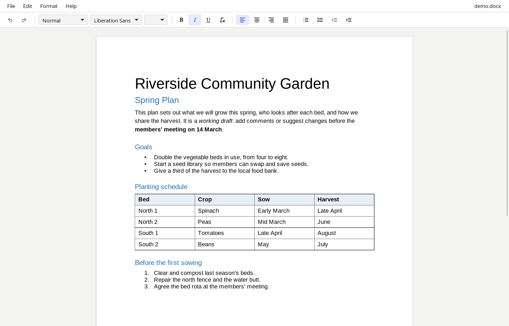
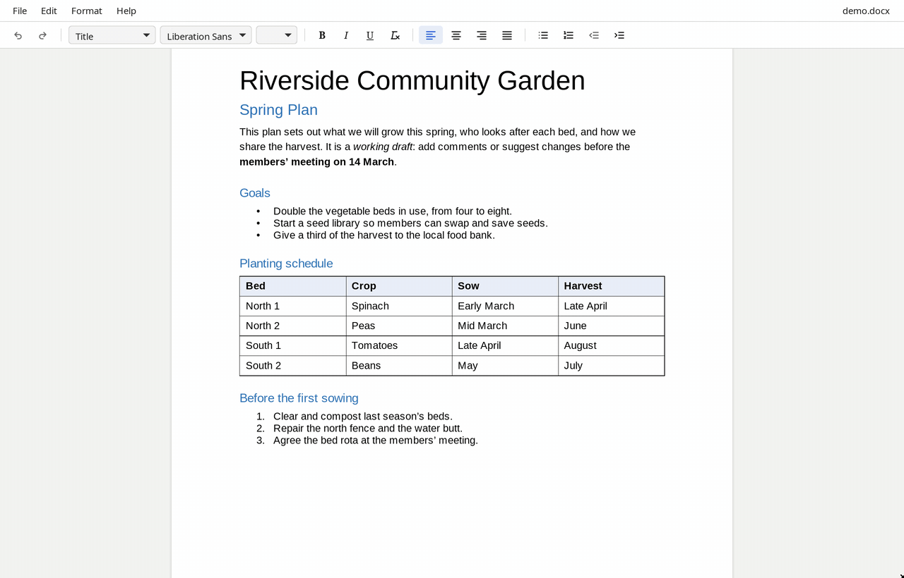
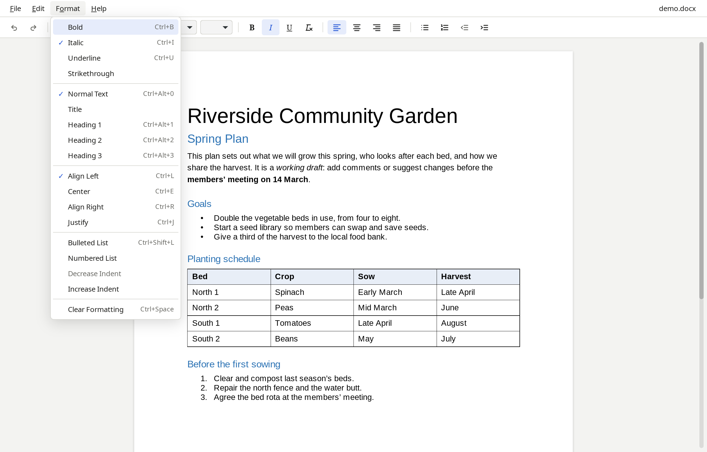
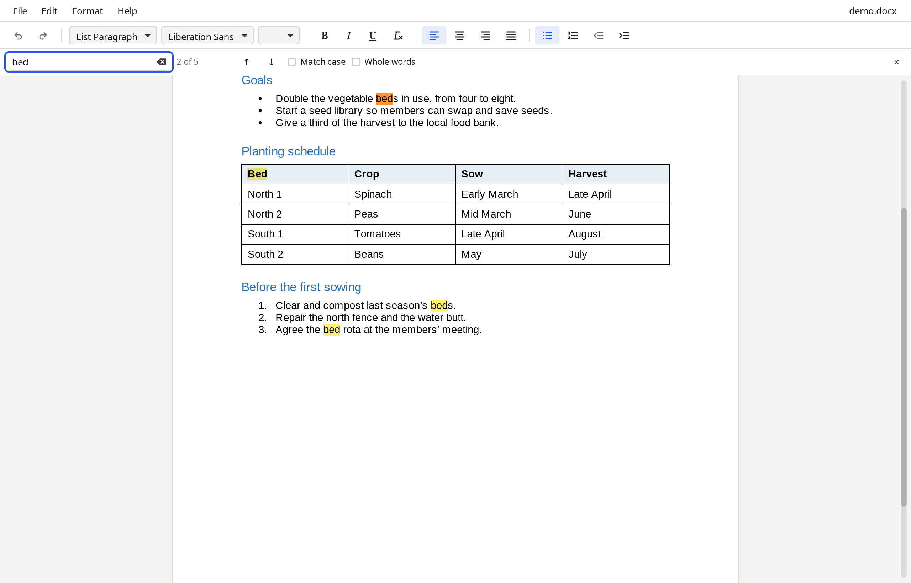

# PageLite

[](https://github.com/sxhumr/linux-document-editor/actions/workflows/ci.yml)

A fast, uncluttered Linux desktop editor for Microsoft Word `.docx` files. It's a small C++ GTK app around an established DOCX engine, with only the menus and buttons everyday editing needs.



## Features

- **Edits real Word documents.** It opens, edits and saves `.docx` files, and keeps what it doesn't edit (comments, tracked changes, footnotes, fields, images, sections) as it was. [Evidence](docs/COMPATIBILITY.md).
- **Essential formatting.** Paragraph styles and headings, font and size, bold, italic, underline, alignment, bulleted and numbered lists, indent, and clear formatting.
- **Keyboard first.** Word and LibreOffice shortcuts, menus you can open and navigate from the keyboard, and incremental Find. Press F1 to see every shortcut.
- **Safe with your work.**
  - Saves are atomic: a crash mid-save never leaves a half-written file.
  - A failed save keeps every edit.
  - Nothing closes or replaces a modified document without asking.
- **Private and offline.** The interface is built into the binary, there is no network access, and documents never leave your machine.
- **Linux native.** A 1.6 MB `.deb` that uses your system's GTK and WebKitGTK, with a desktop entry, an icon and **Open With** for `.docx` files.



| Format menu | Find |
| --- | --- |
|  |  |

## Install

For Ubuntu 24.04 and later (amd64). Download `pagelite_0.1.0_amd64.deb` from the [releases](https://github.com/sxhumr/linux-document-editor/releases) or a CI run, or [build it](#build-from-source), then:

```bash
sudo apt install ./pagelite_0.1.0_amd64.deb   # also installs GTK 3 and WebKitGTK 4.1 if missing
```

Run apt from the folder that holds the file, or give it the full path. With a bare file name, apt looks for a package of that name in the archive instead.

PageLite then appears in the app grid under Office, and under **Open With** for `.docx` files. To make it the default for Word documents:

```bash
xdg-mime default io.github.sxhumr.PageLite.desktop application/vnd.openxmlformats-officedocument.wordprocessingml.document
```

Remove it with `sudo apt remove pagelite`.

## Using it

Open a file from the app grid, from the file manager, or with `pagelite report.docx`. Shortcuts follow Word and LibreOffice:

| Shortcut | Action |
| --- | --- |
| Ctrl+N / Ctrl+O / Ctrl+S / Ctrl+Shift+S | New / Open / Save / Save As |
| Ctrl+Z / Ctrl+Shift+Z (or Ctrl+Y) | Undo / Redo |
| Ctrl+B / Ctrl+I / Ctrl+U | Bold / Italic / Underline |
| Ctrl+L / Ctrl+E / Ctrl+R / Ctrl+J | Align left / Center / Align right / Justify |
| Ctrl+Alt+0 … Ctrl+Alt+3 | Normal text, Heading 1–3 |
| Ctrl+Shift+L | Bulleted list |
| Ctrl+Space | Clear formatting |
| Ctrl+F, then F3 / Shift+F3 | Find, next / previous match |
| Alt+F / Alt+E / Alt+O / Alt+H | Open the File / Edit / Format / Help menu |
| F1 or Ctrl+/ | Every shortcut |

## How it works

```
┌──────────────── pagelite (one 5 MB binary) ────────────────┐
│ C++23 shell              │  React + TypeScript UI           │
│  GTK window, dialogs     │   menus, toolbar, find bar       │
│  WebKitGTK view ─────────┼─► DocumentController (lifecycle) │
│  pagelite:// scheme      │   @docx-editor.dev engine        │
│  path grants, atomic I/O │◄── typed bridge (window.pagelite_*)
└────────────────────────────────────────────────────────────┘
```

- **The shell** owns the window and every file operation. It serves the embedded UI over a private scheme, refuses any other navigation, and reads and writes only paths the user chose in a dialog or on the command line.
- **The engine**, [`@docx-editor.dev/core`](https://github.com/eigenpal/docx-editor) (Apache-2.0), edits the document's own OOXML tree instead of converting it to another model. That is why content it doesn't understand survives a save. It was chosen over SuperDoc and mammoth + docx.js after [round-trip tests](docs/ENGINE_EVALUATION.md).
- **The UI** has one command table that drives the menus, toolbar, shortcuts and Help, and a framework-free `DocumentController` that holds the file lifecycle and its data-safety rules. Both are unit-tested.

The reasons behind each decision are in [`docs/ARCHITECTURE.md`](docs/ARCHITECTURE.md) (ADR-1 to ADR-10).

## Quality

- **Compatibility, tested on every change.**
  - 35 synthetic documents, some written by docx.js and some by LibreOffice, are opened, edited, saved and reopened through the engine.
  - A separate OOXML reader compares 31 features and every package part.
  - All features are kept, unedited parts keep the same content, and malformed files and a decompression bomb are refused.
  - [Results and known differences](docs/COMPATIBILITY.md).
- **About 1,200 automated tests in CI:** Vitest for the UI and compatibility, Catch2 for the C++ shell, plus a job that installs the `.deb` on a clean Ubuntu 24.04 container, opens a document with it and removes it again.
- **Measured startup (warm, i7-8565U laptop).**
  - Empty editor: 0.94 s.
  - A 10 KB document: 1.50 s.
  - Procedure and caveats are in [`docs/TESTING.md`](docs/TESTING.md#performance).
- **Licences checked at build time.** Every embedded component's licence is collected into the package, and an unexpected licence fails the build.

## Limitations

- **Platform:** Ubuntu 24.04+ on amd64 only, and not yet checked in Microsoft Word itself.
- **Editing scope:** the toolbar edits body text. Comments, tracked changes, footnotes and headers are kept, but PageLite has no tools to edit them.
- **Font size picker:** it is blank when the size comes from the document's styles rather than being set on the text.
- **Engine rendering:** tables without cell widths lay out by content, so columns can differ from LibreOffice.

The full list is in [`docs/ARCHITECTURE.md`](docs/ARCHITECTURE.md#known-limitations-milestone-8) and [`docs/COMPATIBILITY.md`](docs/COMPATIBILITY.md).

## Build from source

You need Ubuntu 24.04 or similar, and Node.js 22.18 or later.

```bash
sudo apt install cmake ninja-build pkg-config libgtk-3-dev libwebkit2gtk-4.1-dev
(cd ui && npm ci)

cmake --preset debug && cmake --build --preset debug   # also builds and embeds the UI
./build/debug/native/pagelite [file.docx]

# The Debian package, and its clean-container install test (needs Docker):
cmake --preset package && cmake --build --preset package && cpack --preset deb
packaging/test-deb.sh
```

For UI hot reload in Debug builds, run `(cd ui && npm run dev)`, then `PAGELITE_DEV_SERVER=http://localhost:5173 ./build/debug/native/pagelite`.

| Check | Command |
| --- | --- |
| UI unit tests and DOCX compatibility suite | `cd ui && npm test` |
| Plus the LibreOffice cross-check | `cd ui && npm run test:compat` |
| UI lint, formatting, types | `cd ui && npm run lint && npm run format:check && npm run typecheck` |
| C++ unit tests | `ctest --preset debug` |
| C++ formatting | `clang-format --dry-run --Werror native/src/* native/tests/*` |
| Startup timing | `scripts/measure.sh` |
| Screenshots and demo, from the installed package | `scripts/capture-media.sh` |

## Documentation

| Document | Contents |
| --- | --- |
| [`ARCHITECTURE.md`](docs/ARCHITECTURE.md) | Design, decision records, repository layout, known limitations |
| [`COMPATIBILITY.md`](docs/COMPATIBILITY.md) | What survives a save, with evidence |
| [`TESTING.md`](docs/TESTING.md) | Test layers, the compatibility suite, performance, package test, manual checklist |
| [`ENGINE_EVALUATION.md`](docs/ENGINE_EVALUATION.md) | How the editing engine was chosen |
| [`CHANGELOG.md`](CHANGELOG.md) | Release notes |
| [`plan.md`](plan.md) | The original project brief and milestones |

## Licence

Apache License 2.0; see [LICENSE](LICENSE). Copyright 2026 Sohum Ramouthar. Third-party licences for everything embedded in the binary are installed with the package in `/usr/share/doc/pagelite/THIRD_PARTY_NOTICES.md`.
